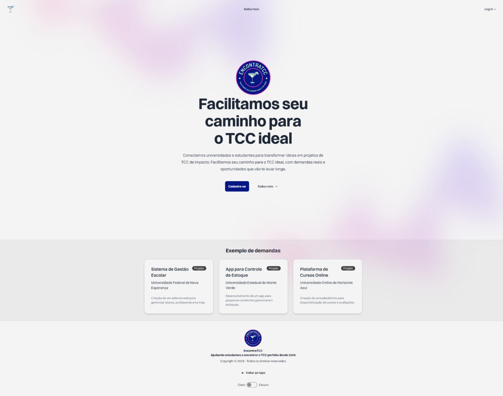
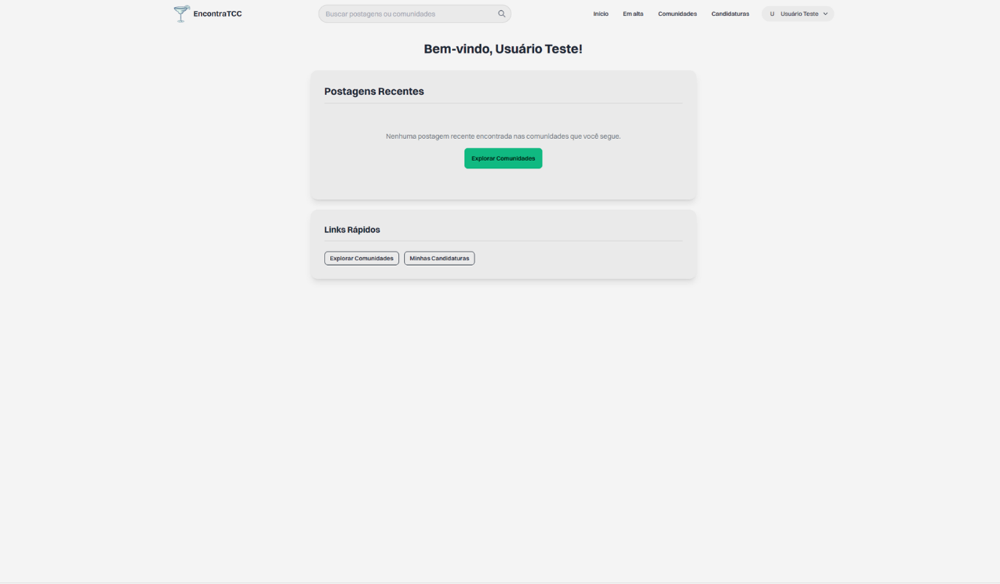
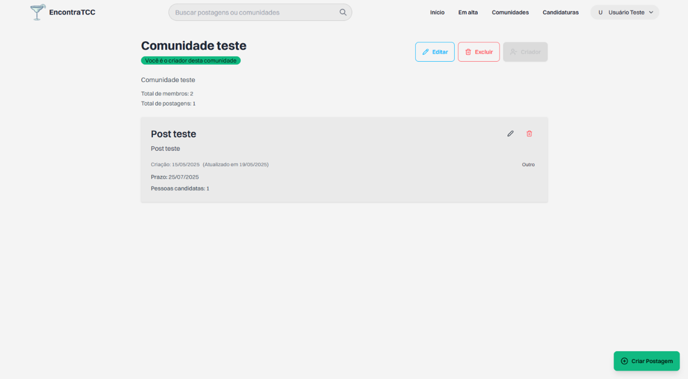
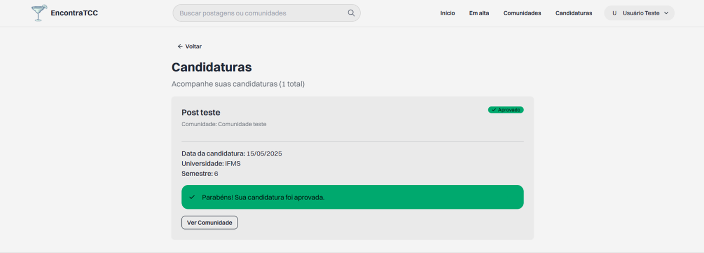

# EncontraTCC

> [Leia em Português 🇧🇷](README.PT-BR.md)


A web platform that connects **students** looking for guidance on their final academic project (TCC) with **professors and researchers** who have compatible projects and research interests. The goal is to make the process of finding a mentor more efficient and transparent for everyone involved.

---

## Table of Contents

- [Screenshots](#screenshots)
- [Features](#features)
- [Tech Stack](#tech-stack)
- [Getting Started](#getting-started)
- [Available Scripts](#available-scripts)
- [Project Structure](#project-structure)
- [Deployment](#deployment)
- [User Roles](#user-roles)
- [Contributing](#contributing)
- [License](#license)

---

## Screenshots

| Landing Page | Dashboard |
|---|---|
|  |  |

| Community | Applications |
|---|---|
|  |  |

---

## Features

### For Students (Discentes)
- Browse communities created by professors
- View published project demands
- Apply for mentorship opportunities
- Track application status

### For Professors / Researchers (Docentes)
- Create and manage thematic communities
- Publish project demands with deadlines and descriptions
- Review and manage received applications

### General
- Secure authentication with email-based password reset
- Personalized dashboard with posts from followed communities
- Trending page with filtering and pagination
- Search for communities and posts
- Light / dark theme

---

## Tech Stack

| Layer | Technology |
|---|---|
| Framework | React 18 + TypeScript |
| Build | Vite 5 |
| Routing | React Router DOM 6 |
| Styling | Tailwind CSS 3 + daisyUI 4 |
| Animations | Framer Motion |
| UI Components | Headless UI, Heroicons, Lucide React |
| Backend / DB | Supabase (PostgreSQL + Auth + RLS) |
| Deploy | Vercel |

---

## Getting Started

### Prerequisites

- [Node.js](https://nodejs.org/) 18 or higher
- A [Supabase](https://supabase.com/) account and project

### Installation

```bash
# Clone the repository
git clone https://github.com/pleasematheus/encontratcc.git
cd encontratcc

# Install dependencies
npm install
```

### Environment Variables

Create a `.env` file at the project root with the following variables:

```env
VITE_SUPABASE_URL=https://<your-project>.supabase.co
VITE_SUPABASE_ANON_KEY=<your-anon-key>
```

These values are available under **Project Settings → API** in the Supabase dashboard.

### Running in Development

```bash
# Compile Tailwind CSS in watch mode (terminal 1)
npm run tailwatch

# Start the Vite development server (terminal 2)
npm run dev
```

The server will be available at `http://localhost:5173`.

---

## Available Scripts

| Script | Description |
|---|---|
| `npm run dev` | Starts the local development server |
| `npm run dev:network` | Starts the server accessible on the local network |
| `npm run build` | Compiles TypeScript and generates the production build |
| `npm run preview` | Previews the production build locally |
| `npm run lint` | Runs ESLint |
| `npm run tailwatch` | Compiles Tailwind CSS in watch mode |
| `npm run tailbuild` | Compiles and minifies Tailwind CSS for production |

---

## Project Structure

```
src/
├── assets/          # Images and logos
├── components/      # Reusable components (Header, Footer, Cards, etc.)
├── hooks/           # Custom hooks (useTheme)
├── lib/             # General utilities
├── middleware/      # Authenticated route guards
├── routes/          # Page components (one folder per route)
└── utils/
    └── supabase.ts  # Supabase client initialization
```

---

## Deployment

The project is configured for deployment on **Vercel**. The `vercel.json` file includes the rewrite rule required for SPA routing:

```json
{
  "rewrites": [{ "source": "/(.*)", "destination": "/" }]
}
```

To deploy, connect the repository to Vercel and set the `VITE_SUPABASE_URL` and `VITE_SUPABASE_ANON_KEY` environment variables in the project settings.

---

## User Roles

| Role | Description |
|---|---|
| **Discente** | Student looking for mentorship who applies to projects |
| **Docente** | Professor or researcher who publishes demands and selects candidates |

---

## Contributing

Contributions are welcome! To get started:

1. Fork the repository
2. Create a branch for your feature or fix (`git checkout -b feature/my-feature`)
3. Commit your changes (`git commit -m 'feat: add my feature'`)
4. Push to your branch (`git push origin feature/my-feature`)
5. Open a Pull Request

Please keep PRs focused — one feature or fix per PR makes review much easier.

---

## License

Distributed under the **Apache 2.0** license. See the [LICENSE](LICENSE) file for more details.
